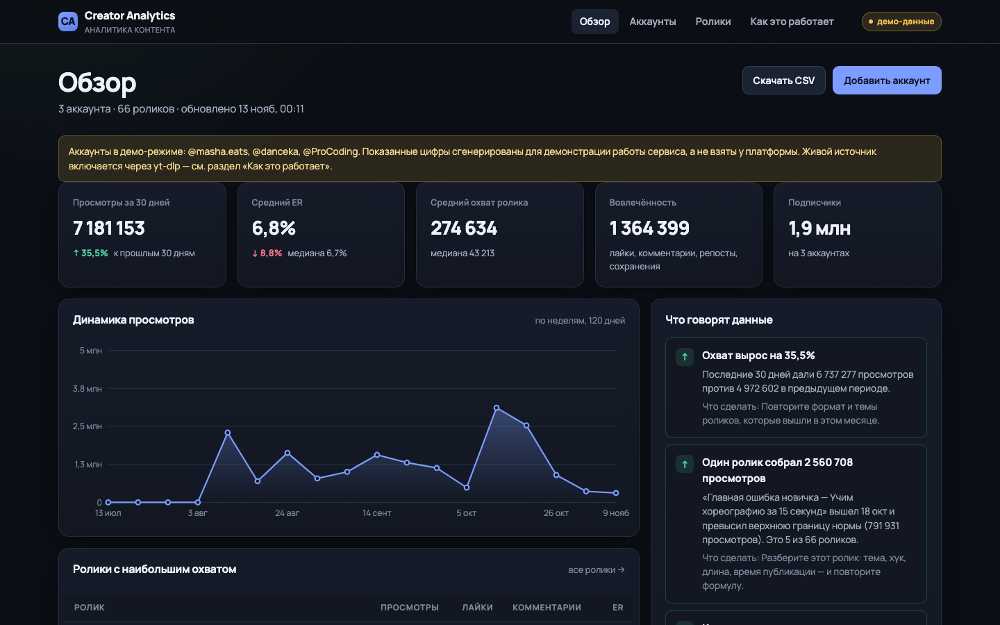

# Creator Analytics

Веб-сервис аналитики контента креаторов: собирает публичные ролики с аккаунтов в
Instagram, YouTube и TikTok, считает метрики и разбирает содержание — темы,
хештеги, приёмы подачи, тональность.



## Что умеет

- **Аккаунты.** Добавление по ссылке или `@нику`, синхронизация последних
  роликов, удаление вместе с данными.
- **Сравнение.** 2–4 аккаунта и произвольный период в одной таблице: кто растёт
  быстрее, у кого выше ER, кто держит ритм. Выбор хранится в ссылке.
- **Автообновление.** Фоновая синхронизация по расписанию с джиттером:
  метрики не стареют, пока вы не зашли на сайт. После ошибки источника пауза
  растёт экспоненциально, поэтому сервис не устраивает шторм повторов.
- **Метрики.** ER, охват, медианы, вовлечённость, динамика периода, ритм
  публикаций, лучшее время выхода.
- **Анализ содержания.** Темы с множителем охвата, хештеги, приёмы подачи
  (вопрос, призыв, цифры, личный опыт), тональность.
- **Выводы.** Короткие наблюдения на естественном языке с указанием данных, на
  которых они основаны.
- **Выгрузка.** CSV для Excel и таблиц.

## Быстрый старт

Нужен Node.js 22.5 или новее (используется встроенный `node:sqlite`).

```bash
npm ci
npm start
```

Откройте <http://127.0.0.1:4180>. На пустой базе автоматически появятся три
демо-аккаунта — по одному на платформу, чтобы интерфейс было видно сразу.

## Источник данных

По умолчанию `PROVIDER=auto`: если в системе есть `yt-dlp`, сервис попробует
взять реальные публичные данные, иначе переключится на демо-режим.

| Режим | Поведение |
| --- | --- |
| `demo` | Детерминированные данные, сеть не нужна. Всегда подписаны в интерфейсе как демонстрационные |
| `ytdlp` | Реальные публичные данные через `yt-dlp` |
| `auto` | `ytdlp`, если доступен, иначе `demo` |

> Демо-данные — не статистика реальных аккаунтов. Они нужны, чтобы показать
> работу анализа там, где платформы недоступны: Instagram и TikTok ограничивают
> автоматический доступ, а YouTube может быть закрыт на уровне сети.

Чтобы включить живые данные: установите `yt-dlp` и задайте `PROVIDER=ytdlp`.

```bash
PROVIDER=ytdlp YTDLP_PATH=/путь/к/yt-dlp npm start
```

## Настройка

Все параметры — переменные окружения, файл `.env.example` содержит значения по
умолчанию.

| Переменная | По умолчанию | Назначение |
| --- | --- | --- |
| `PORT` | `4180` | Порт сервера |
| `HOST` | `127.0.0.1` | Адрес прослушивания |
| `DATA_DIR` | `data` | Каталог с базой SQLite |
| `APP_TIME_ZONE` | `Europe/Moscow` | Часовой пояс для расчёта лучшего времени |
| `SEED_DEMO` | `true` | Наполнять пустую базу демо-аккаунтами |
| `SYNC_LIMIT` | `24` | Сколько последних роликов забирать |
| `PROVIDER` | `auto` | Источник данных |
| `YTDLP_PATH` | `yt-dlp` | Путь к yt-dlp |
| `SYNC_SCHEDULER` | `true` | Фоновая синхронизация по расписанию |
| `SYNC_INTERVAL_MINUTES` | `180` | Интервал синхронизации аккаунта, минуты |
| `SYNC_TICK_MS` | `60000` | Как часто планировщик проверяет расписание |
| `SYNC_BACKOFF_MINUTES` | `15` | База паузы после ошибки источника |
| `SYNC_BACKOFF_MAX_MINUTES` | `720` | Потолок паузы после ошибок |

## Команды

```bash
npm start          # запуск сервера
npm test           # юнит- и интеграционные тесты
npm run test:e2e   # вёрстка, контраст и сценарии в браузере
npm run test:all   # всё подряд
npm run demo:seed  # добавить демо-аккаунты
npm run demo:reset # пересоздать базу с демо-данными
npm run screenshots # снять кадры в docs/screenshots/
```

## Устройство

```
src/
  analysis/   метрики, анализ текста, правила выводов
  db/         схема и репозитории поверх node:sqlite
  lib/        даты, морфология, разбор ссылок
  providers/  demo и ytdlp за одним интерфейсом
  services/   сборка данных для страниц, демо-наполнение
  ui/         шаблоны, компоненты, страницы
public/       стили, клиентский скрипт, шрифты
scripts/      сервер, демо-данные, скриншоты, проверки вёрстки
tests/        юнит, API, сценарии в браузере
docs/         ТЗ, план, скриншоты
```

Ограничения и определения метрик подробно описаны в [docs/TZ.md](docs/TZ.md),
ход реализации — в [docs/PLAN.md](docs/PLAN.md).

## Фоновая синхронизация

Сервис сам обновляет метрики: раз в `SYNC_INTERVAL_MINUTES` (по умолчанию три
часа) на аккаунт, со случайным разбросом, чтобы не бить в платформу пачкой.
На странице аккаунта видно, когда следующий запуск и почему он отложен.

Если источник вернул ошибку (`bot_check`, `rate_limited`, таймаут), пауза
удваивается с каждой попыткой и упирается в `SYNC_BACKOFF_MAX_MINUTES`. Для
`bot_check` и `rate_limited` база вчетверо больше: частые повторы усугубляют
блокировку. Один аккаунт никогда не синхронизируется дважды одновременно —
второй запрос получает `409` и `status: "busy"`.

Отключить фон можно `SYNC_SCHEDULER=false`; тогда метрики обновляет только
кнопка «Синхронизировать».

## Приватность

Сервис работает на вашем сервере, база — локальный файл SQLite. Тексты роликов не
отправляются во внешние сервисы анализа. Наружу уходят только запросы к самим
платформам за публичными данными, если включён живой режим. Cookies и пароли
сервис не запрашивает и не хранит.

Авторизации нет: сервис рассчитан на локальный запуск или доверенную сеть.

## Лицензия

Учебный проект, распространяется как есть.
